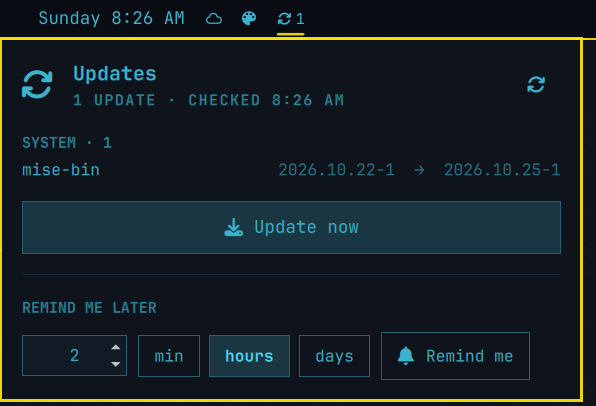

# Omarchy Updates

A bar widget for [Omarchy](https://omarchy.org) that shows pending **system (pacman)**,
**AUR** and **mise tool** updates (everything `omarchy-update` installs). Click it to see exactly what will change, start the update, or snooze
it for however long you like.



- **Bar icon:** a refresh icon with the pending count. It's hidden when you're up to date
  and dimmed while a reminder is snoozed. Left click opens the popup; right click shows or
  hides the count.
- **Popup:** every pending package with `old → new` versions, grouped into System, AUR and
  Tools (mise, i.e. CLIs installed through `mise`, checked against your global config).
  `omarchy` itself is pinned to the top in bold when it has an update. The corner button
  (or `r`) checks again.
- **Update now:** runs `omarchy-update` in the standard floating terminal (the same thing
  the built-in update icon does), then refreshes the list when the update releases its lock.
- **Remind me later:** pick a number and *min / hours / days*. When it expires you get an
  "Updates available" notification; clicking it starts the update. The last amount and
  unit you used are remembered.

It checks 20 s after the shell starts, then hourly, and again when you open the popup if
the last check is more than 10 minutes old. Failed checks (e.g. offline) are retried every
5 minutes, and the last good list is kept in the meantime.

## Install

```bash
omarchy plugin add https://github.com/GhostDrift/omarchy-updates.git --enable --yes
```

It covers everything the built-in `omarchy.system-update` icon does, so you'll probably
want to swap that one out of your bar. In `~/.config/omarchy/shell.json`, replace
`{ "id": "omarchy.system-update" }` with `{ "id": "jessica.updates" }`, or move it into
place with `omarchy bar move jessica.updates --section center`.

If an edit to the plugin doesn't show up, run `omarchy restart shell`.

### Optional: daily notification

`bin/update-check-notify` sends an "Updates available" notification at most once a day
and stays quiet while a reminder is snoozed. To run it at login and hourly (it only
notifies once per day):

```bash
cp ~/.config/omarchy/plugins/jessica.updates/extras/systemd/update-check-notify.* ~/.config/systemd/user/
systemctl --user daemon-reload
systemctl --user enable --now update-check-notify.timer update-check-notify.service
```

Pass `--force` to run it now, ignoring both the daily stamp and the snooze.

## IPC

```bash
omarchy-shell jessica.updates toggle    # open | close | toggle
omarchy-shell jessica.updates refresh   # re-check now
```

## Dependencies

Nothing beyond a stock Omarchy install: `checkupdates` (pacman-contrib), `yay`, `mise`, `jq`, `flock`,
and Omarchy's own `omarchy-update` and `omarchy-notification-send`. It never installs
anything on its own and needs no sudo; the update itself runs in a terminal you can see.

## Files it writes

`~/.local/state/update-check/` contains `last-checked` (the daily notification's date
stamp) and `snooze-until` (the reminder time, as a Unix epoch). Delete the directory for a
clean slate.

## Remove

```bash
omarchy plugin remove jessica.updates
```

## License

MIT
